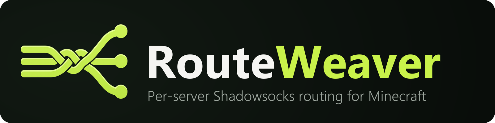

<div align="center">



**A client-side Fabric mod that sends connections to the Minecraft servers you choose through
Shadowsocks proxies, and leaves every other server on a direct connection.**

[](https://github.com/DverkaSK/RouteWeaver/actions/workflows/build.yml)
[](https://github.com/DverkaSK/RouteWeaver/releases/latest)
[](https://github.com/DverkaSK/RouteWeaver/releases)
[](LICENSE.txt)
<br>
[](#requirements)
[](https://fabricmc.net/)
[](#how-it-works)

[Download](https://github.com/DverkaSK/RouteWeaver/releases) ·
[Usage](#usage) ·
[Configuration](#configuration) ·
[Building](#building) ·
[Issues](https://github.com/DverkaSK/RouteWeaver/issues)

</div>

## Features

- **Per-server routing**: pick a saved multiplayer server, pick a proxy, click *Save route*.
- **Pattern rules**: `mc.example.net`, `*.example.net` or `*`, with an optional port filter.
- **Built-in Shadowsocks client**: AEAD ciphers `chacha20-ietf-poly1305`, `aes-256-gcm` and
  `aes-128-gcm`. No external proxy software is required.
- **`ss://` import**: paste a SIP002 or legacy link and the profile fills itself in.
- **Virtual hosts keep working**: the handshake still carries the original host name.
- **Server list untouched**: pings in the multiplayer list always go direct.
- English and Russian interface.

## Requirements

| Minecraft | Fabric Loader | Fabric API | Java | Branch                                                        |
|-----------|---------------|------------|------|---------------------------------------------------------------|
| 1.21.11   | 0.18.4+       | any        | 21+  | [`1.21.11`](https://github.com/DverkaSK/RouteWeaver/tree/1.21.11) |
| 26.1.2    | 0.19.2+       | any        | 25+  | [`26.1.2`](https://github.com/DverkaSK/RouteWeaver/tree/26.1.2)   |

This is the `1.21.11` branch.

[owo-lib](https://github.com/wisp-forest/owo-lib) and the Kotlin standard library are bundled in
the jar, so Fabric API is the only other mod you need.

## Usage

1. Download `routeweaver-<version>+<minecraft>.jar` from
   [Releases](https://github.com/DverkaSK/RouteWeaver/releases) and drop it into `mods/` together
   with [Fabric API](https://modrinth.com/mod/fabric-api).
2. Open **Multiplayer** and press **RouteWeaver** in the top-right corner.
3. On **Proxies**, add a profile (or import an `ss://` link).
4. On **Servers**, select a server, choose the proxy and press **Save route**.

Join the server as usual. Rules are evaluated top to bottom and the first enabled rule whose proxy
is enabled wins; if none matches, the connection goes direct.

## How it works

When you join a server, RouteWeaver decides the route from the address exactly as you typed it.
For a proxied server it swaps the socket address for a tunnel on `127.0.0.1` (port `39753` by
default), and the tunnel relays the connection through Shadowsocks to the real server. The
handshake still carries the original host name, so virtual-hosted servers keep working. The
server-list pinger is never redirected.

The mod is client-side only; servers don't need it.

## Configuration

Everything set in the GUI is stored in `config/routeweaver/config.json`:

```json
{
  "schemaVersion": 1,
  "tunnelPort": 39753,
  "profiles": [
    { "id": "nl", "name": "Netherlands", "host": "203.0.113.10", "port": 8388,
      "method": "chacha20-ietf-poly1305", "password": "…", "enabled": true }
  ],
  "rules": [
    { "id": "hypixel", "label": "Hypixel", "serverPattern": "*.hypixel.net", "port": 0,
      "proxyProfileId": "nl", "enabled": true }
  ]
}
```

`port: 0` means any port. A file that fails to parse is kept as `config.json.broken`.

## Building

```sh
./gradlew build          # jar in build/libs, runs the unit tests
./gradlew runClient      # development client
```

All versions (Minecraft, Fabric, owo-lib, Kotlin) live in `gradle.properties`.

## Branches and releases

Each supported Minecraft version has its own branch, named after the version (`1.21.11`,
`26.1.2`). Fixes land on one branch and are cherry-picked to the others.

To release, bump `mod_version` in `gradle.properties` on the branch, then push a tag named
`v<mod_version>+<minecraft_version>`:

```sh
git tag v1.0.0+1.21.11
git push origin v1.0.0+1.21.11
```

The *Release* workflow checks that the tag matches `gradle.properties`, builds and tests the mod,
and publishes the jar as a GitHub release. Every push also runs the *Build* workflow, which
uploads the jars as an artifact.

## Project layout

```
src/main/     version-independent core, covered by unit tests
  config/     config model, JSON store, ss:// parser
  routing/    rule matching and route decisions
  proxy/      Shadowsocks AEAD client and the local tunnel (Kotlin)
src/client/   Minecraft integration
  client/     entrypoint and runtime
  client/gui/ config screen (owo-lib)
  mixin/      connect-flow and multiplayer-screen hooks
agent/        deprecated standalone Go agent, kept for reference
docs/assets/  logo and icon
```

## License

[MIT](LICENSE.txt).
